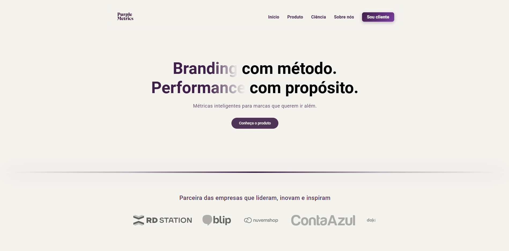

<p align="center">
  
</p>

<p align="center">
Plataforma de atribuição de marketing focada em branding, performance e inteligência de dados.
</p>

<p align="center">
  
  
  
  
</p>

---

## Sobre o Projeto

**Purple Metrics** é uma landing page institucional desenvolvida para apresentar uma solução de atribuição de marketing voltada à análise de performance e branding.

O projeto foi concebido com foco em transmitir credibilidade, inovação e inteligência estratégica, destacando os diferenciais da plataforma através de uma experiência visual moderna e objetiva.

Toda a interface foi construída priorizando:

- Design clean e contemporâneo
- Hierarquia visual bem definida
- Identidade visual corporativa
- Layout responsivo
- Comunicação orientada à conversão

---

## Design & Conceito

A proposta do projeto foi inspirada em empresas modernas de tecnologia e marketing analytics, utilizando uma linguagem visual minimalista para valorizar dados, produto e experiência do usuário.

A construção visual buscou unir:

- Branding estratégico
- Marketing orientado por dados
- Performance digital
- Experiência intuitiva
- Design responsivo

---

## Tecnologias Utilizadas

### Front-end

- HTML5
- CSS3
- JavaScript (ES6+)

---

## Funcionalidades

- Apresentação institucional da plataforma
- Navegação suave entre seções
- Estrutura responsiva para desktop e mobile
- Call-to-actions estratégicos
- Destaque para parceiros e credibilidade da marca
- Layout focado em experiência do usuário
- Interface moderna e otimizada

---

## Estrutura do Projeto

```bash
📦 PurpleMetrics
 ┣ 📂 assets
 ┣ 📜 index.html
 ┣ 📜 style.css
 ┣ 📜 script.js
 ┗ 📜 README.md
```

---

## Objetivo Acadêmico

Projeto desenvolvido como parte das atividades acadêmicas da **Unicesumar**, aplicando conceitos de desenvolvimento Front-end, design responsivo e construção de landing pages institucionais para produtos digitais.

---

## Preview do Projeto

Acesse a versão online do projeto:

🔗 **[Purple Metrics](https://purple-metrics-unicesumarprojeto.vercel.app/index.html)**

---

## Autor

**Eryck Ferreira**

Desenvolvedor Front-end em formação e apaixonado por criar interfaces modernas, funcionais e visualmente impactantes.

---
